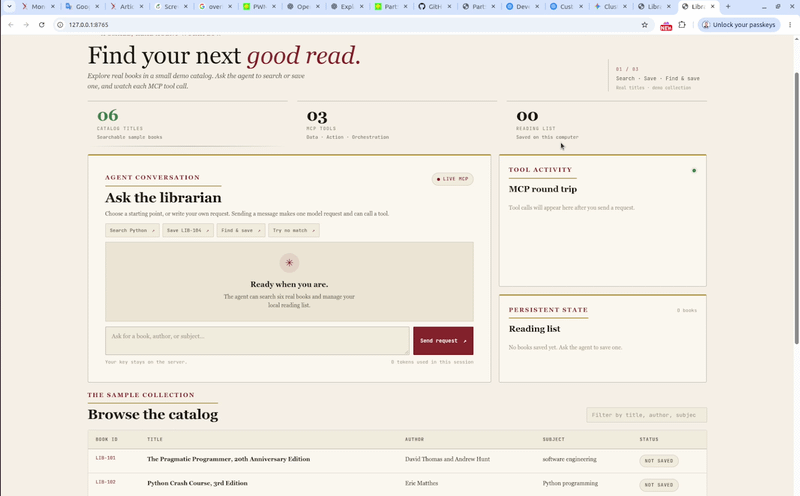

# Campus Library MCP Agent

A local library agent demo with three MCP tools, a browser interface, and a persistent reading list. Its catalog contains six real published books for demonstration; it is not a live campus library catalog.



[Watch the screencast on YouTube](https://www.youtube.com/watch?v=ZRopVOM7Vnw)

## Tools

| Tool | Purpose |
| --- | --- |
| `search_catalog` | Find books by title, author, subject, or ID. |
| `save_to_reading_list` | Save a book by ID to the local SQLite reading list. |
| `find_and_save_book` | Find one matching book, then save it. |

The agent uses the OpenAI Agents SDK to call a FastMCP server over standard input and output. Blank searches and invalid save requests return clear errors.

## Set up

Requires Python 3.11+ and an OpenAI API key.

```bash
python3 -m venv .venv
.venv/bin/python -m pip install -e '.[test]'
```

Create a `.env` file in the project folder:

```text
OPENAI_API_KEY=your-key-here
```

`.env` is ignored by Git. Set `OPENAI_MODEL` there if you want to override the default model.

## Run

Launch the browser interface:

```bash
.venv/bin/python -m library_agent.web --open
```

It opens at `http://127.0.0.1:8765`. Use **Focus view** for a compact demo, and stop the server with Ctrl+C.

For a command-line demo or local tests:

```bash
.venv/bin/python -m library_agent.client --demo --trace
PYTEST_DISABLE_PLUGIN_AUTOLOAD=1 .venv/bin/python -m pytest
```

See [the demo guide](DEMO_GUIDE.md), [written summary](WRITTEN_SUMMARY.md), and [reflection](REFLECTION.md) for the assignment details.
